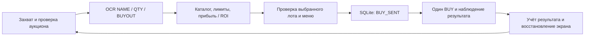

# StalBot

Локальное Windows-приложение для аукциона Stalzone: распознаёт лоты на экране,
сверяет их с каталогом SQLite и выбирает покупку по прогнозной прибыли или ROI.
Проект объединяет компьютерное зрение, обработку неопределённых данных,
автоматизацию интерфейса и восстановление после незавершённых действий.

**Стек:** Python 3.12 · Tkinter · NumPy/OpenCV/Pillow · RapidOCR/ONNX Runtime
(CPU или DirectML) · Tesseract через tesserocr · SQLite · Windows API.

[Архитектура](docs/ARCHITECTURE.md) · [OCR и измерения](docs/OCR.md) ·
[Руководство пользователя](docs/USAGE.md) · [Тестирование](docs/TESTING.md) ·
[Аудит для разработчиков, 20.10.2026](docs/AUDIT_2026-10-20.md)

## Что реализовано

- FreshLots: первые девять строк группами 1/3/9; лучший допустимый лот
  в первой группе с кандидатами. При равенстве выбирается верхняя строка.
- Каталог закупки: имя, цвет, точная заточка или диапазон, цены за штуку,
  ограничение стака. Пересечения правил отклоняются.
- Раздельное распознавание имени, количества и полной цены выкупа;
  точный LRU-кеш только для имени, цвета и заточки с сохранением на диск.
- Replay скриншота, одноразовое наблюдение без кликов, проверка меню без BUY
  и непрерывная автопокупка. По умолчанию выбран режим наблюдения.
- Ручной бюджет или опциональный OCR игрового счёта, журнал попыток,
  фильтры истории и прогноз прибыли после комиссии 5%.
- Пауза F8, стоп F9, проверка окна, курсорный ввод и опциональный PostMessage.

Автоматическая перепродажа не реализована. Цены предполагаемой продажи задаёт
пользователь: прогноз не является фактически полученной прибылью.

## Как устроен цикл



Логика экономики находится в [domain.py](stalbot/domain.py), выбор — в
[scanner.py](stalbot/scanner.py), цикл — в [runner.py](stalbot/runner.py),
транзакции — в [storage.py](stalbot/storage.py). UI передаёт события через очередь;
native OCR создаётся, используется и закрывается в одном рабочем потоке.
Рабочие модули не импортируют исследовательские скрипты.

Перед вводом BUY намерение фиксируется в SQLite. Незавершённые попытки блокируют
новый BUY и после перезапуска. Неизвестный результат обрабатывается отдельно от
успеха: при ручном бюджете возможная стоимость резервируется после восстановления
экрана, при OCR баланса выполняется сверка. Подробная семантика — в
[руководстве](docs/USAGE.md#неопределённость-и-история).

## Проверенное состояние

Аудит от 20 октября 2026: **342 теста бота и Tk прошли**.
[Лог](validation/portfolio-audit-20261020-01/bot-tests.log).
20 тестов Builder и полная CPU OCR-регрессия также прошли. Общая команда тестов
benchmark пока завершается ImportError в устаревшем прототипе.
Результаты проверок и воспроизведения замечаний — в
[отчёте аудита](docs/AUDIT_2026-10-20.md).

Контрольный OCR-набор содержит 170 строк из 17 скриншотов:

| Поле | Результат контрольного набора | Как интерпретировать |
|---|---|---|
| NAME | 170/170 по тексту и признаку сокращения | Число конечных точек отдельно не сравнивается |
| Цвет | 170/170 | На предоставленных изображениях |
| QTY | 53/54 видимых чисел | 53 принятых значения верны; остальные случаи могут быть AMBIGUOUS |
| BUYOUT | 146/153 видимых числовых цен | 146 принятых значений верны; отказ допустим |

Набор использовался для выбора обработки и содержит повторяющиеся кропы; это
регрессия, а не независимая оценка обобщения. Нулевая наблюдённая опасная числовая
ошибка не гарантирует её отсутствия на новых кадрах. Метрики, знаменатели и
ограничения раскрыты в [OCR](docs/OCR.md#что-измерено).

Пользователь подтвердил полный цикл автопокупки 15.10.2026. Это не подтверждение
всех последующих изменений: новая подготовка Search, полный цикл с OCR баланса,
интегрированный фоновый ввод и ускоренные настройки требуют отдельной игровой
проверки. Актуальные статусы — в [плане разработки](DEVELOPMENT_PLAN.md).

## Установка и запуск

Поддерживаемая конфигурация: **Windows x64, CPython 3.12 с Tcl/Tk**.
Живой захват рассчитан на основной экран 1920×1080 и видимую игру,
покрывающую его. Курсорный ввод дополнительно требует активного окна игры.
Replay принимает RGB 1920×1080 и 1920×1081 без масштабирования.

Все команды выполняются из корня проекта. Если готовое окружение уже существует,
повторно создавать его не нужно. Для нового окружения:

```powershell
py -3.12 -m venv .venv-benchmark
.\.venv-benchmark\Scripts\python.exe -m pip install -r requirements-bot.txt
```

До запуска подготовьте локальные файлы:

```text
benchmarks/models/
  rapid/cyrillic_PP-OCRv5_rec_mobile.onnx
  tessdata/rus.traineddata
  tessdata/eng.traineddata
```

Установка пакетов не устанавливает эти веса. Сейчас перенос моделей ручной;
автоматического загрузчика с опубликованным манифестом источников нет.
Необходимость этого шага — известный недостаток воспроизводимости новой установки.
Описание моделей — в [OCR](docs/OCR.md), исследовательское окружение — в
[benchmarks/README.md](benchmarks/README.md). UI-шаблоны `assets/ui/` также необходимы.

После подготовки запустите `Start_StalBot.cmd` или:

```powershell
.\.venv-benchmark\Scripts\python.exe main.py
```

Рабочая БД при первом запуске пустая. Для проверки интерфейса и тестов ядра
не нужны игровая сессия и OCR-веса; для распознавания и Replay веса нужны.

## Первое знакомство без покупки

1. Запустите тесты по команде ниже — они используют временные БД и fake desktop.
2. Откройте UI и добавьте реальное правило на вкладке «Каталог»: полное имя,
   цвет/заточку и закупочную/продажную цену за штуку.
3. Выберите «Replay: выбрать скриншот» и чистое изображение аукциона. Replay
   не отправляет ввод в игру; UI сохраняет настройки и событие в своей БД.
4. Для анализа живого экрана выберите «Наблюдение». Проверка меню уже отправляет
   Search и выбор строки; BUY в этом режиме не отправляется.

Для изолированного CLI Replay используйте отдельные БД и кеш:

```powershell
.\.venv-benchmark\Scripts\python.exe main.py --replay "dataset\templates\Обычный скриншот.png" --db "data\demo\replay.sqlite3" --name-cache-dir "data\demo\name-cache" --group-size 3 --selection-metric profit --output "data\demo\replay.json"
```

Пустая отдельная БД даст разбор строк без кандидата для покупки. Полный список
аргументов: `main.py --help`. Команды GUI-примеров, настройка ввода, история,
бюджет и диагностика — в [руководстве пользователя](docs/USAGE.md).

## Проверки для разработчика

Быстрая проверка экономики, каталога, SQLite и контроллера покупки:

```powershell
.\.venv-benchmark\Scripts\python.exe -m unittest discover -s tests -p test_bot.py -v
```

Полный набор бота включает Tk/clipboard и требует Windows desktop-сессию:

```powershell
.\.venv-benchmark\Scripts\python.exe -m unittest discover -s tests -v
```

Полная OCR-регрессия требует модели и датасет; каждый результат сохраняйте под
новым именем:

```powershell
.\.venv-benchmark\Scripts\python.exe tools\validate_bot.py --dataset dataset --models benchmarks\models --output validation\integration-NEW.json
```

Успех подтверждается кодом завершения 0 и `Integration regression passed`.
Реальные покупки не используются как автоматический тест. Проверки Builder,
benchmark-скриптов и маршруты по типам изменений — в [TESTING](docs/TESTING.md).

## Известные ограничения

- Геометрия и пороги изображения рассчитаны на конкретный интерфейс; другие
  разрешения, масштаб и оформление не поддержаны автоматически.
- AMBIGUOUS QTY остаётся неизвестным количеством. Для экономики используется
  нижняя оценка 1; она не доказывает соблюдение верхнего ограничения стака.
- Сокращение имени может быть уникальным в закупочном каталоге и совпадать
  с другим предметом вне каталога. OCR и каталог не дают серверный ID лота.
- Стабильность пикселей после Search — эвристика. Статический режим не проверяет
  обновление; отключённый повторный OCR допускает подмену строки.
- В режиме OCR баланса завершённый BALANCE_MISMATCH сохраняется для аудита,
  но покупки продолжаются с прочитанным балансом. Это явная политика текущей версии.
- Автоматическая чистая установка, CI, лицензия проекта и демонстрационный
  скриншот для публичного портфолио пока не подготовлены.

Замечания с приоритетами, доказательствами и критериями исправления — в
[аудите](docs/AUDIT_2026-10-20.md). Игровые предпосылки — в
[GAME_RULES](docs/GAME_RULES.MD).

## Структура и данные

| Путь | Назначение |
|---|---|
| `main.py`, `Start_StalBot.cmd` | CLI и запуск UI |
| `stalbot/` | Рабочее приложение |
| `tests/`, `tools/` | Регрессии и проверочные инструменты |
| `dataset/` | Builder, ручная разметка, изображения и кропы |
| `benchmarks/` | Исследовательские скрипты, отчёты и локальные модели |
| `validation/` | Контрольный baseline и результаты проверок |
| `data/` | Локальные настройки, БД, кеш, диагностика и errors.log |

`data/` исключён через `.gitignore`; рабочую БД и полные снимки экрана не включайте
в портфолио. Отдельный Builder использует `.venv`:
[инструкция](dataset/README_builder.md). В проверенной папке нет `.git`; ссылки
на историю коммитов и релиз здесь не заявляются.
